# Sequence diagrams

Every runtime flow, traced from the code. The River job queue lives in the same Postgres database (`river_job`); it is drawn as its own participant only to show when jobs are inserted and picked up. A grey box is one database transaction.

Participants: **BB** Bitbucket, **API** `--mode=api`, **W** `--mode=worker`, **Q** River queue, **DB** Postgres, **LLM** the reviewer (`claude -p` or mock), **UI** Next.js server, **B** browser.

## 1. Webhook ingest

`POST /webhooks/bitbucket` (`httpapi/webhook.go`, `store/events.go`). Only `repo:push` gets a job. Other events are stored and nothing more.

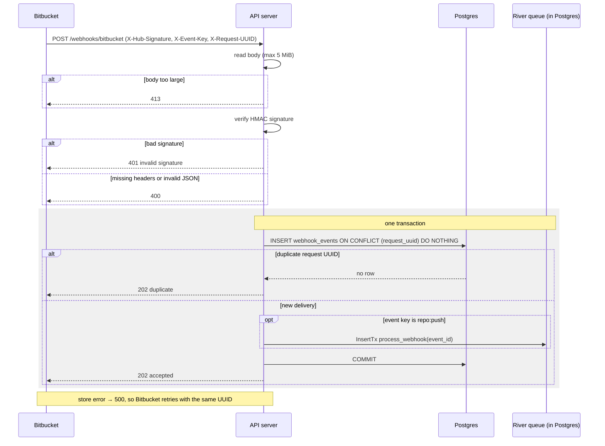

## 2. Process webhook job

`process_webhook` on the default queue, up to 4 at a time (`worker/process.go`, `ingest/ingest.go`).

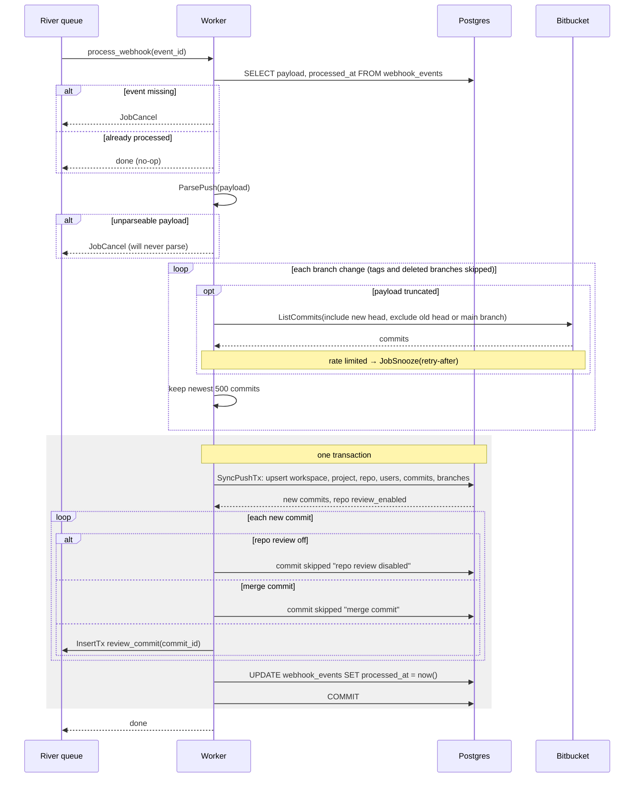

## 3. Commit review job

`review_commit` on the `review` queue. One runs at a time (`MaxWorkers: 1`), with a 10 min timeout and 5 attempts (`worker/review.go`, `review/pipeline.go`).

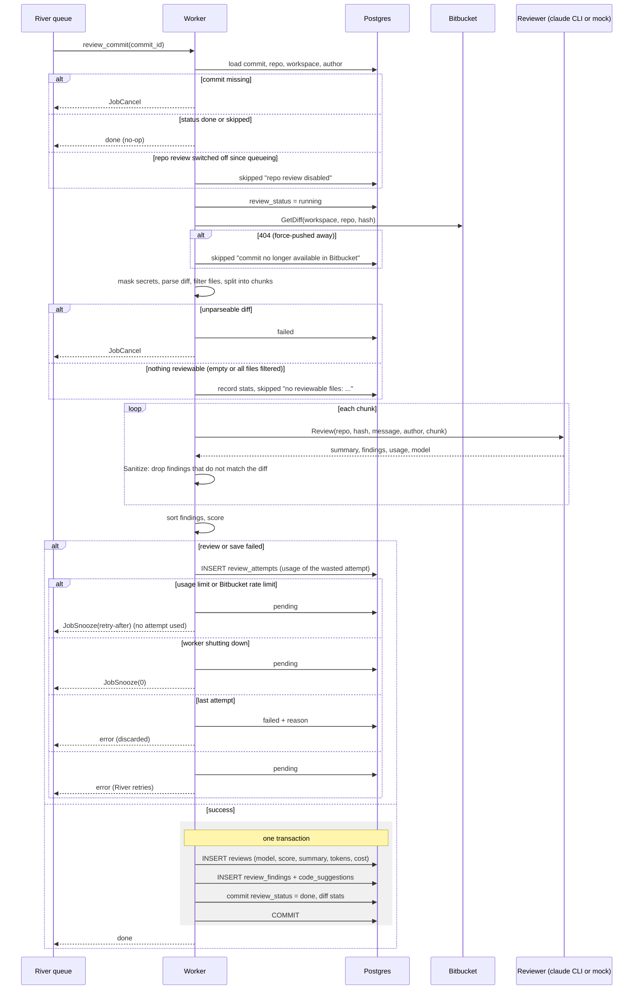

## 4. Poll round: commits

`poll_repos` runs on a timer (`POLL_INTERVAL`) and at start, only when `POLL_REPOS` is set. Only one round runs at a time (`worker/poll.go`).

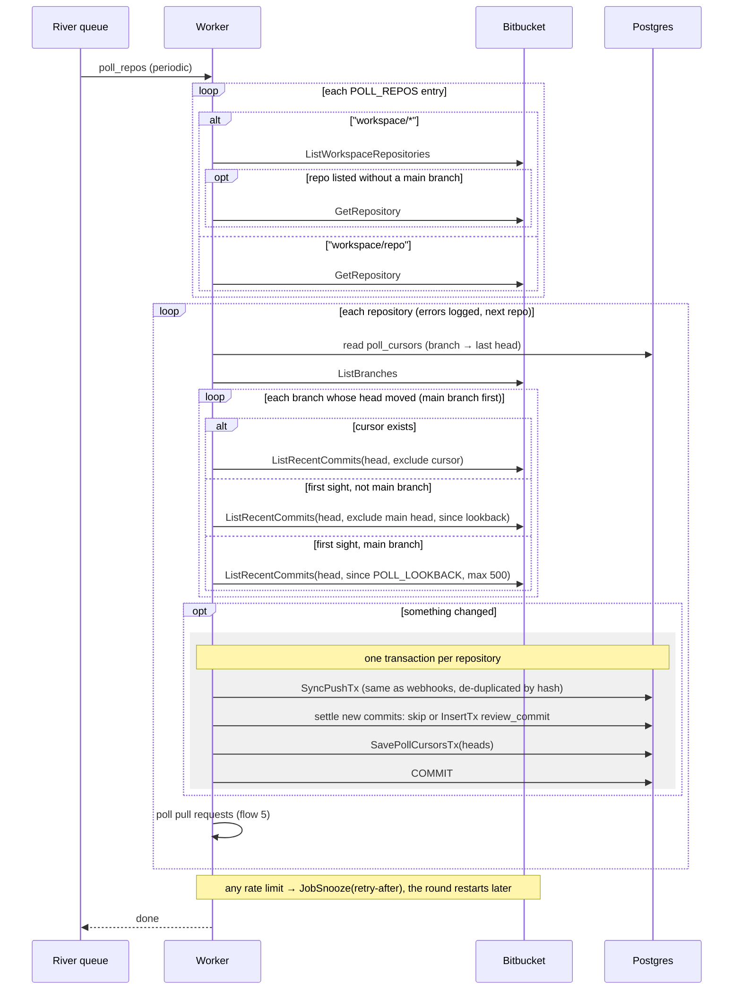

## 5. Poll round: pull requests

This step runs per repository inside the same `poll_repos` round, after that repository's commits (`worker/pollpr.go`).

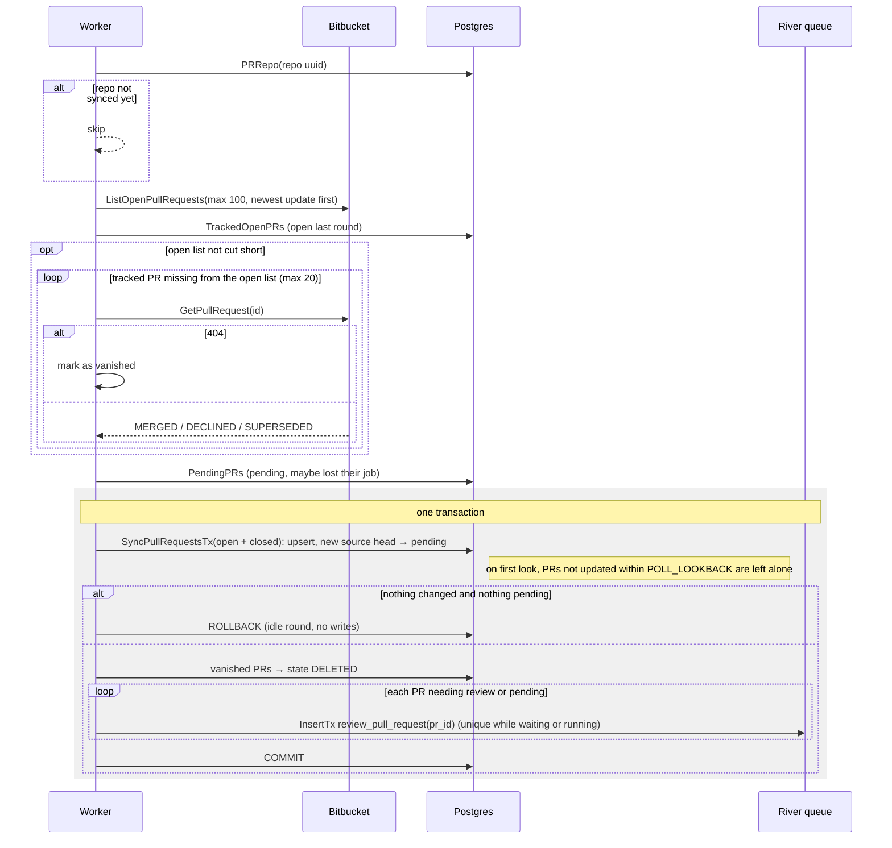

## 6. Pull request review job

`review_pull_request` on the `review` queue. It shares the single review worker with commit reviews (`worker/reviewpr.go`).

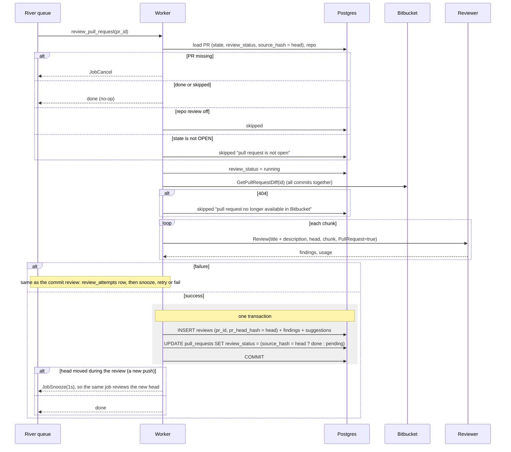

## 7. Reconcile (self-repair)

`reconcile` runs every `RECONCILE_INTERVAL` and at start, as one transaction with `FOR UPDATE SKIP LOCKED`. It only touches rows that have no live job and were not settled in the last 5 min (`worker/reconcile.go`).

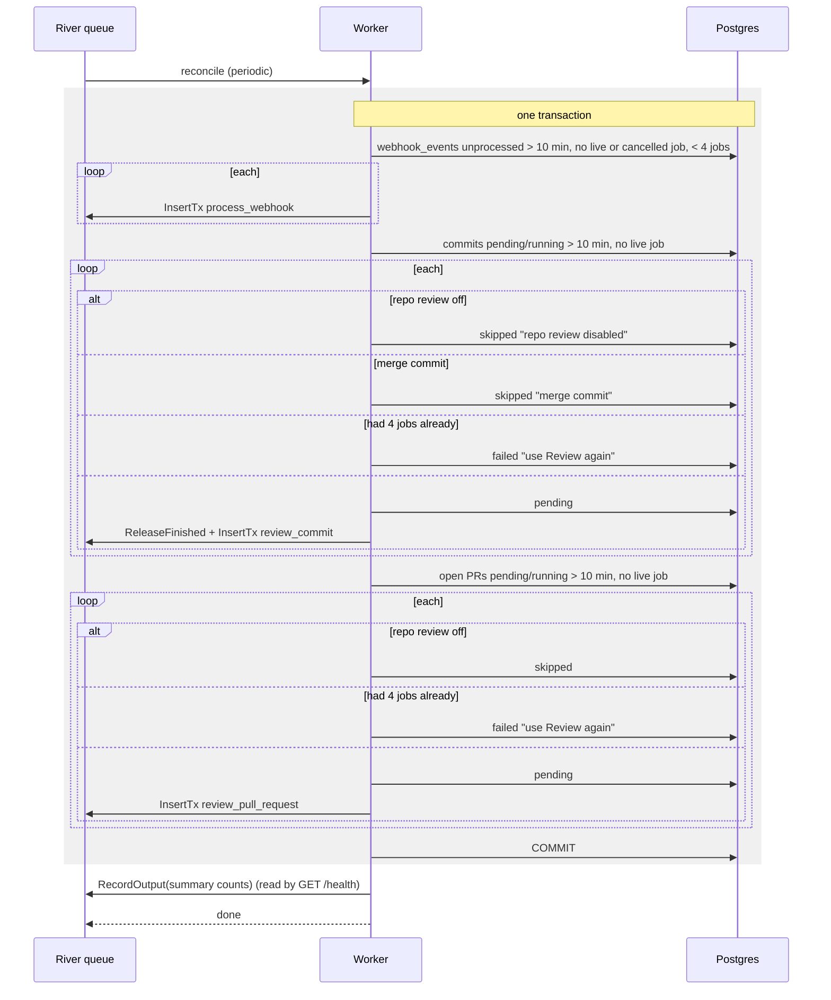

## 8. Directory sync

`sync_directory` runs every `DIRECTORY_SYNC_INTERVAL` (default 24h) and at start. When the token cannot read a place (401/403/404), that place is skipped and logged once per pass (`worker/directory.go`).

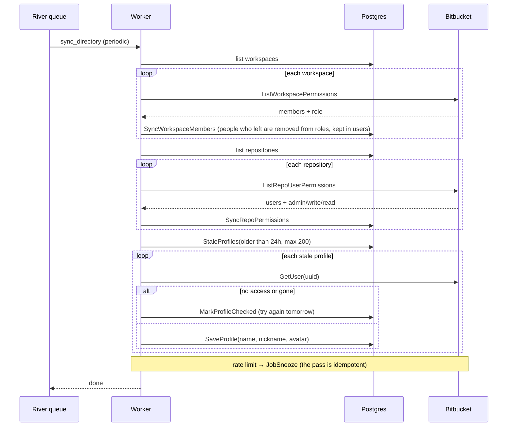

## 9. Backfill (one-off)

`server --mode=backfill` is a separate process. It only inserts jobs and never runs them (`worker/backfill.go`).

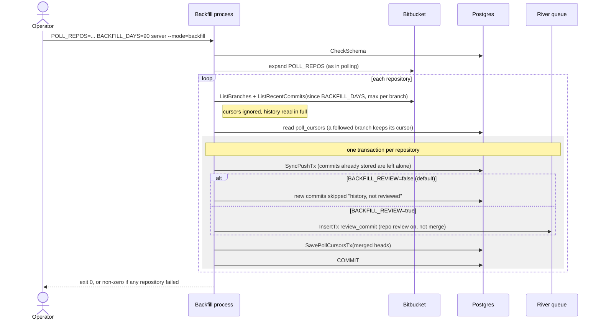

## 10. Dashboard read (every page)

Pages are Next.js server components, so the browser never calls the API. The same path serves Overview, commits, pull requests, repositories, users, search, My work (`/me/work`), health and audit (admin only) (`frontend/lib/api.ts`, `lib/guard.tsx`, `restapi/restapi.go`).

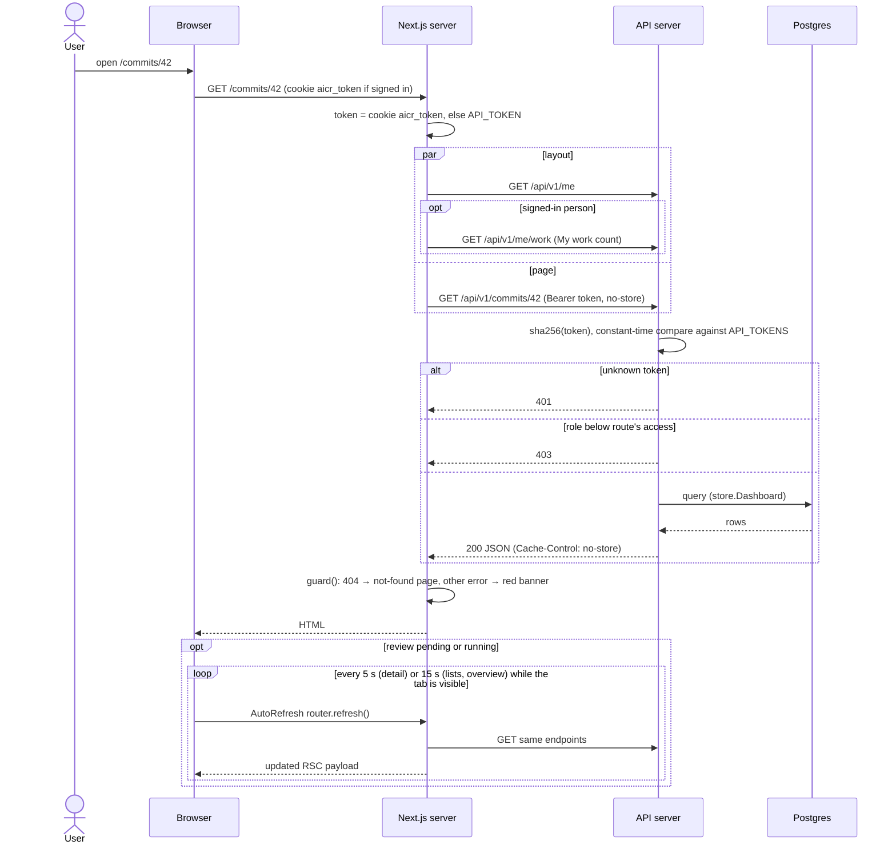

## 11. Sign in and sign out

`frontend/app/signin/actions.ts`. The personal token replaces the shared `API_TOKEN` for every API call that follows.

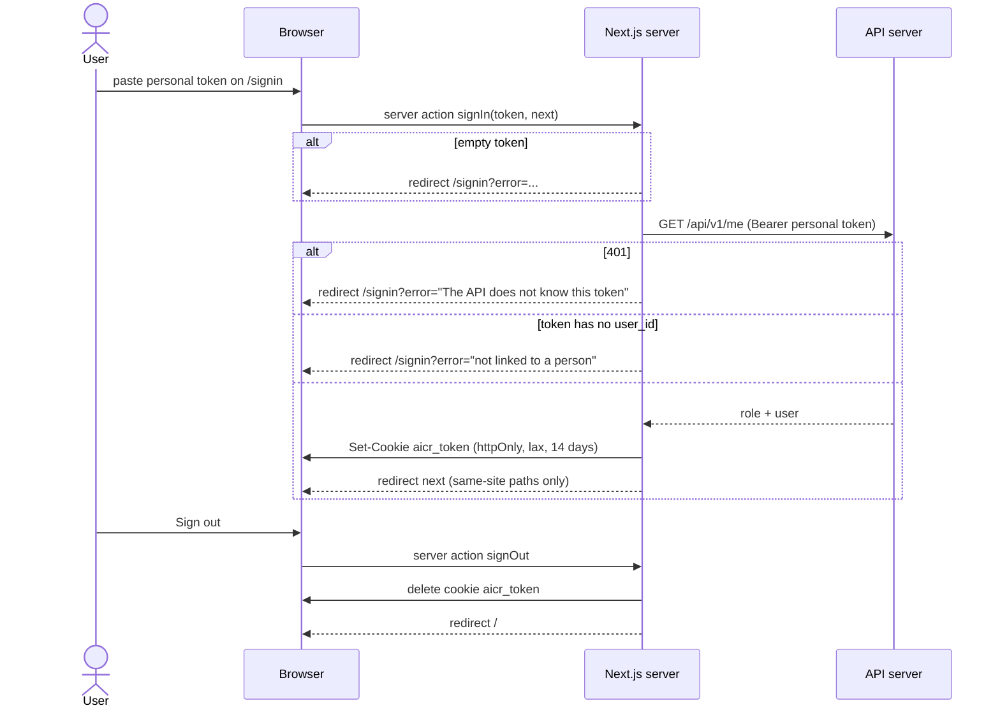

## 12. Fix workflow: author fixes, senior closes

`frontend/app/workflow/actions.ts` calls `POST /findings/{id}/fixed|reopen|dismiss` and `POST /reviews/{id}/close`. The store decides who may do what (`store/workflow.go`). Each change and its audit row are written in one transaction.

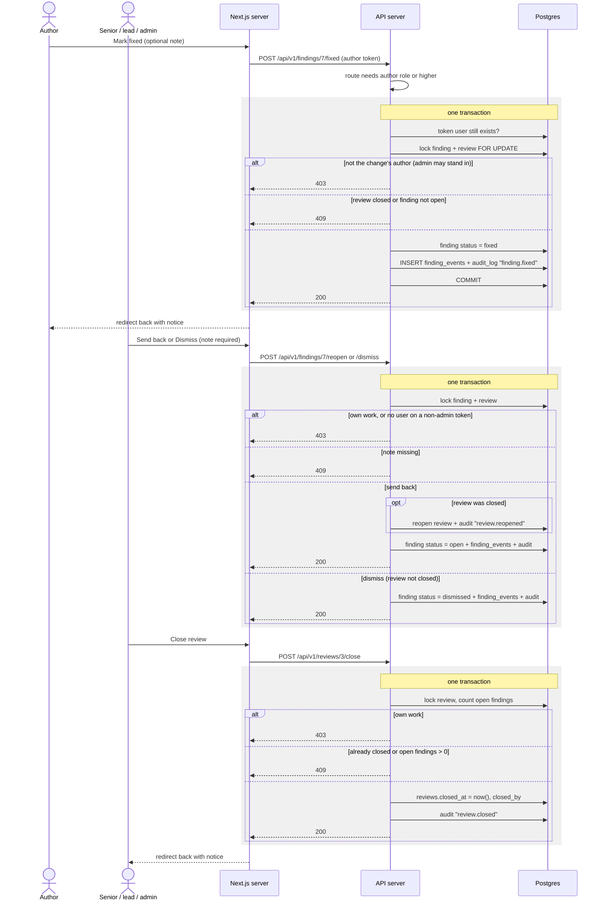

## 13. Review again (commit or pull request)

Admin only. Commits use `store.Rereview` and pull requests use `store.RereviewPullRequest`. The job is picked up by flow 3 or flow 6.

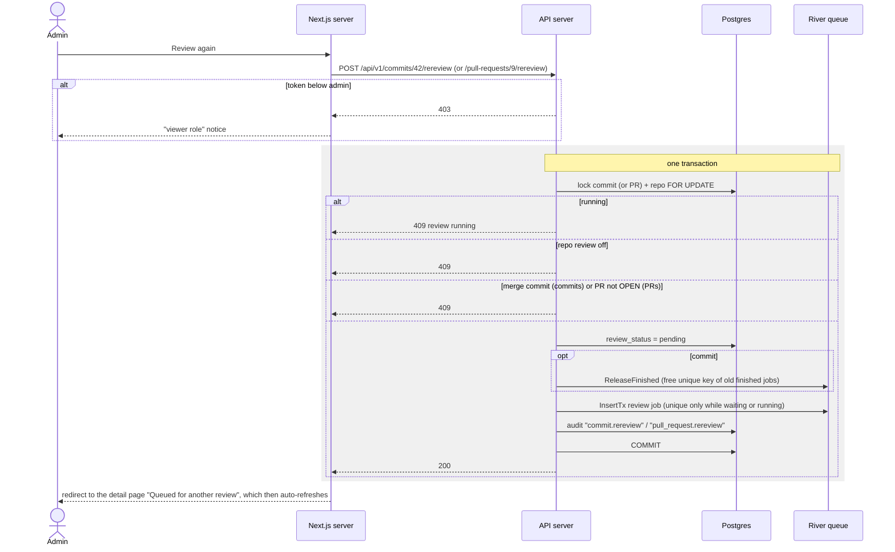

## 14. Repository review on/off

Admin only (`PATCH /api/v1/repositories/{id}`). Commits already queued see the new value when their job runs: flow 3 skips them if review is now off.

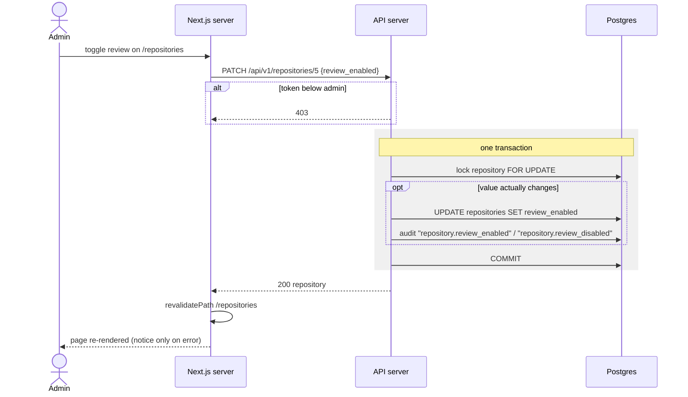
